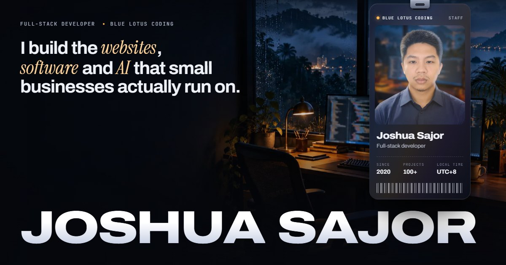

## Hi, I'm Joshua.

**Full-stack developer at [Blue Lotus Coding](https://bluelotuscoding.com) · Philippines (UTC+8)**

I build the websites, software and AI that small businesses run on. I've been shipping for paying clients since 2020, with 100+ projects delivered: storefronts, booking flows, dashboards, a production CRM and the integrations between them. I'm open to remote full-stack roles and selected client projects.

**[Portfolio](https://joshua-sajor-portfolio.vercel.app)** · **[Demo gallery](https://demo.bluelotuscoding.com)** · **[Résumé](https://joshua-sajor-portfolio.vercel.app/Joshua_Corbe_Sajor_Resume.pdf)** · **[joshuasajor28@gmail.com](mailto:joshuasajor28@gmail.com)**

### Featured work

| Project | What it is | Built with |
|---|---|---|
| **Blue Lotus CRM** [Case study](https://joshua-sajor-portfolio.vercel.app/crm) | The private sales platform Blue Lotus Coding runs on, with 1,300+ deals in it. Features: <ul><li>realtime pipeline and team chat</li><li>shift-aware access</li><li>a website scanner that writes the call notes</li><li>an MCP API that lets AI agents work deals with staff permissions</li></ul>The code is private; walkthrough on request. | React 19, TypeScript, Supabase (Postgres, Row Level Security, Realtime, Edge Functions), MCP, Puppeteer, Lighthouse |
| **Demo gallery** [Code](https://github.com/AsianDoesCodin/blue-lotus-demos) · [Live](https://demo.bluelotuscoding.com) | Ten clickable demo sites for ten kinds of business, each in its own design language with a working core flow. | HTML, CSS, vanilla JavaScript |
| **RELAY** [Live](https://demo.bluelotuscoding.com/relay/) · [Case study](https://joshua-sajor-portfolio.vercel.app/relay) | An automation hub for a plumbing and HVAC company. Its flows are node graphs with test runs, streaming logs and a savings dashboard. | Vanilla JavaScript, SVG |
| **Skillset** [Live](https://demo.bluelotuscoding.com/skillset/) · [Case study](https://joshua-sajor-portfolio.vercel.app/skillset) | Puts a generic AI answer next to one that uses the business's own skills, so owners can see the difference. | Vanilla JavaScript |
| **Client studios** [Example](https://github.com/AsianDoesCodin/sanders-signature-clean) · [Case study](https://joshua-sajor-portfolio.vercel.app/clients) | Five or six complete website directions per real local business, compared side by side on phone and desktop. | Vite, vanilla JavaScript |
| **This portfolio** [Code](https://github.com/AsianDoesCodin/joshua-sajor-portfolio) · [Live](https://joshua-sajor-portfolio.vercel.app) | A multi-page static site built from one layout by a small Node script. It is accessible, fast and has no runtime dependencies. | HTML, CSS, JavaScript, Node.js |

### Toolkit

- **Languages:** TypeScript, JavaScript, SQL, HTML, CSS, Python
- **Frontend:** React, Astro, Vite, responsive UI, accessibility
- **Backend & data:** Node.js, Supabase, PostgreSQL, Firebase, REST APIs
- **Security:** authentication, authorization, Row Level Security
- **Delivery:** Git, GitHub, Vercel, Netlify, AWS
- **AI workflows:** Claude, Codex, Copilot, MCP servers, skill files

### How I work

I wrote code by hand for four years before AI tools arrived. Now I use them the way a senior engineer uses a good team: I delegate, review every change, and own the result.
